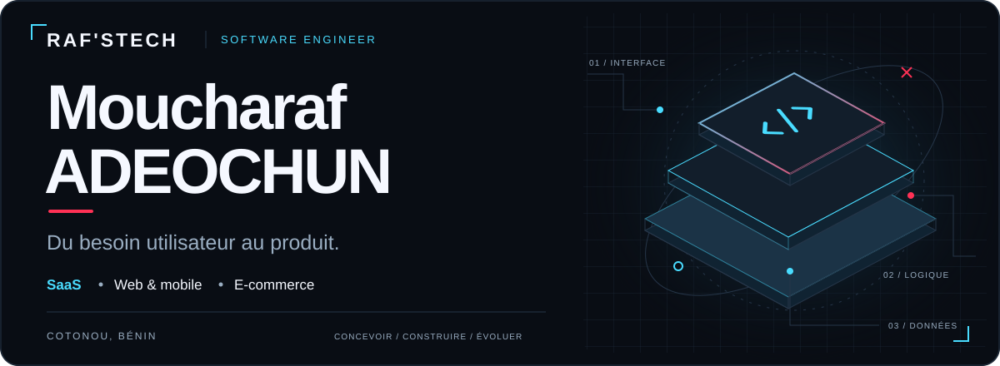
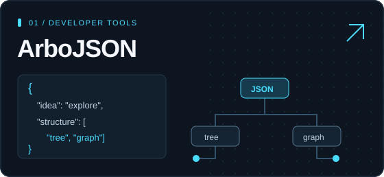
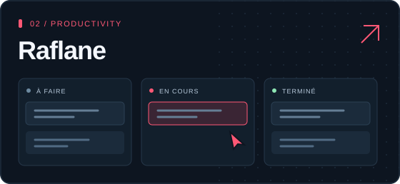
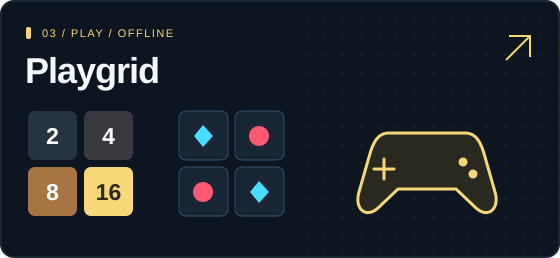
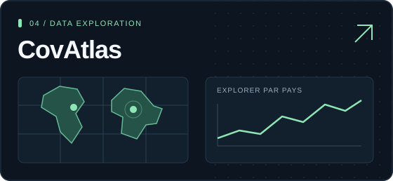

<picture>
  <source media="(max-width: 600px) and (prefers-color-scheme: light)" srcset="./assets/hero-mobile-light.svg">
  <source media="(max-width: 600px)" srcset="./assets/hero-mobile-dark.svg">
  <source media="(prefers-color-scheme: light)" srcset="./assets/hero-light.svg">
  
</picture>

  <a href="https://rafstech-portfolio.vercel.app/"><strong>Explorer mon portfolio ↗︎</strong></a>
  &nbsp; · &nbsp;
  <a href="https://www.linkedin.com/in/moucharaf-adeochun/">LinkedIn</a>
  &nbsp; · &nbsp;
  <a href="mailto:moucharafadeochun59@gmail.com">Parlons de ton projet</a>

# Du besoin utilisateur au produit.

Moi, c'est **Moucharaf ADEOCHUN**, alias **RAF'STECH**, ingénieur logiciel à **Cotonou, Bénin**. Je conçois des **SaaS**, des applications **web et mobiles** et des solutions **e-commerce sur mesure**. J'aime transformer un besoin concret en un outil utile, puis le faire évoluer avec ses utilisateurs.

Aujourd'hui chez **Vertim Coders**, je développe notamment des plugins **WordPress et WooCommerce**, des fonctionnalités métier et des applications avec **Laravel, React et Flutter**.

## 01 / Des idées qui prennent forme

Quatre projets personnels, quatre façons de construire. Les visuels ouvrent leur fiche sur mon portfolio.

<table>
  <tr>
    <td width="50%" valign="top">
      
    </td>
    <td width="50%" valign="top">
      
    </td>
  </tr>
  <tr>
    <td width="50%" valign="top">
      
    </td>
    <td width="50%" valign="top">
      
    </td>
  </tr>
</table>

- **[ArboJSON](https://rafstech-portfolio.vercel.app/projects/arbojson)** — Éditer, valider et explorer du JSON en arbre ou en graphe. `Next.js` `TypeScript` · [Essayer ↗︎](https://arbojson.vercel.app/)
- **[Raflane](https://rafstech-portfolio.vercel.app/projects/raflane)** — Organiser les tâches avec listes, cartes, glisser-déposer et sauvegarde locale. `React` `TypeScript` · [Essayer ↗︎](https://raflane.vercel.app/)
- **[Playgrid](https://rafstech-portfolio.vercel.app/projects/playgrid)** — 2048, puzzle, jeu de mots et memory, avec sauvegarde des parties et mode hors ligne. `React` `PWA` · [Jouer ↗︎](https://rafplaygrid.vercel.app/)
- **[CovAtlas](https://rafstech-portfolio.vercel.app/projects/covatlas)** — Explorer des données COVID-19 par pays avec carte interactive et indicateurs. `React` `Leaflet` `Chart.js` · [Explorer ↗︎](https://covatlas.vercel.app/)

## 02 / Du code au terrain

**Ingénieur logiciel chez Vertim Coders · Depuis novembre 2025**

Je participe à la conception, au développement, à la maintenance et à l'évolution de solutions digitales. Deux contributions aux produits de l'équipe :

**[QuoteFlow ↗︎](https://rafstech-portfolio.vercel.app/projects/quoteflow)** 
Contribution au développement d'un plugin WordPress/WooCommerce de **tarification dynamique et de demandes de devis** : formules de prix, règles conditionnelles et options personnalisées.

**[ASO — All Sign Customizer ↗︎](https://rafstech-portfolio.vercel.app/projects/all-sign-customizer)** 
**Refonte des vues, de la logique applicative et des API** d'un configurateur WooCommerce pour la personnalisation de produits.

## 03 / Ma boîte à outils

| Pour construire… | J'utilise… |
| :--- | :--- |
| Des interfaces web | `React` `Next.js` `TypeScript` `JavaScript` `Tailwind CSS` |
| Des backends et des fonctionnalités métier | `Laravel` `PHP` `MySQL` `REST API` |
| Des expériences e-commerce | `WordPress` `WooCommerce` · plugins et intégrations sur mesure |
| Des applications mobiles | `Flutter` `Dart` |
| Des explorations en vision par ordinateur | `Python` `OpenCV` |
| Un historique de travail partagé | `Git` `GitHub` |

<strong>04 / Le parcours derrière les projets</strong>

- **Depuis novembre 2025 — Vertim Coders** : ingénieur logiciel, SaaS, web, mobile et e-commerce.
- **2025 — FIFACOM** : stage professionnel en développement web backend, avec Laravel, React et intégration d'API.
- **2022–2025 — ESM-BENIN** : licence en Systèmes informatiques et logiciels.

**Un autre terrain d'exploration : la vision par ordinateur.** Mon [projet de pointage par reconnaissance faciale](https://rafstech-portfolio.vercel.app/projects/face-recognition) utilise Python et OpenCV pour la détection en temps réel, l'administration et les rapports de présence.

---

  <strong>Une idée, un besoin métier, un produit à faire évoluer ?</strong> 
  <a href="mailto:moucharafadeochun59@gmail.com">Échangeons →</a>
  &nbsp; · &nbsp;
  <a href="https://rafstech-portfolio.vercel.app/">Portfolio</a>
  &nbsp; · &nbsp;
  <a href="https://www.linkedin.com/in/moucharaf-adeochun/">LinkedIn</a>

